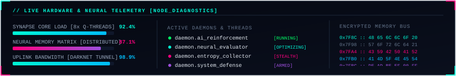

<div align="center">

  <!-- CYBERNETIC TERMINAL ANIMATED HUD HEADER -->
  <a href="https://github.com/cybparam">
    
  </a>

  <br/>

  <!-- DYNAMIC TYPING SVG STREAM -->
  <a href="https://github.com/cybparam">
    
  </a>

  <!-- STATUS CHIPS & METRICS -->
  <p>
    <a href="https://github.com/cybparam?tab=repositories">
      
    </a>
    <a href="https://github.com/cybparam">
      
    </a>
    <a href="https://github.com/cybparam">
      
    </a>
    <a href="https://github.com/cybparam">
      
    </a>
  </p>

</div>

<a href="https://github.com/cybparam">
  
</a>

<br/>

<!-- DYNAMIC TERMINAL SESSION CARD -->
<div align="center">
  <a href="https://github.com/cybparam">
    
  </a>
</div>

<br/>

<!-- ADVANCED NETRUNNER CASCADE & TACTICAL RADAR HUD -->
<div align="center">
  <a href="https://github.com/cybparam">
    
  </a>
</div>

<br/>

<a href="https://github.com/cybparam">
  
</a>

### ⚡ `// 01. ACTIVE CYBER PAYLOADS & REPOSITORIES`

<!-- DYNAMIC LIVE REPOSITORY CARDS -->
<div align="center">
  <a href="https://github.com/cybparam/tic-tac-toe-ai">
    
  </a>
  &nbsp;
  <a href="https://github.com/cybparam/cybparam">
    
  </a>
</div>

<br/>

| Targeted Node | Signal & Mission Classification | Protocol | Status |
| :--- | :--- | :---: | :---: |
| **[tic-tac-toe-ai](https://github.com/cybparam/tic-tac-toe-ai)** | Self-learning reinforcement agent trained over 200,000 game cycles. | `Q-LEARNING / PY` | `● DEPLOYED` |
| **[cybparam](https://github.com/cybparam/cybparam)** | Root configuration dossier & live telemetry terminal dashboard. | `MARKDOWN / SVG` | `● LIVE` |
| **[neural-vault](https://github.com/cybparam?tab=repositories)** | Experimental autonomous neural networks & algorithmic exploration. | `AI / EXPLORATION` | `○ IN PROGRESS` |

<br/>

<a href="https://github.com/cybparam">
  
</a>

### 📊 `// 02. LIVE TELEMETRY & MAINFRAME METRICS`

<div align="center">
  <!-- Interactive Terminal Stats Simulation -->
  <a href="https://github.com/cybparam">
    
  </a>
</div>

<br/>

<div align="center">
  <!-- GitHub Readme Stats & Top Languages with Custom Cyberpunk Theme -->
  <a href="https://github.com/cybparam">
    
  </a>
  &nbsp;
  <a href="https://github.com/cybparam">
    
  </a>
</div>

<br/>

<div align="center">
  <!-- Contribution Streak with Cyberpunk Palette -->
  <a href="https://github.com/cybparam">
    
  </a>
</div>

<br/>

<!-- Real-time Hardware & Neural Telemetry HUD Widget -->
<a href="https://github.com/cybparam">
  
</a>

<br/>

<a href="https://github.com/cybparam">
  
</a>

### 🔒 `// 03. CLASSIFIED ENCRYPTED ARCHIVES`

<details>
  <summary><b>▶ <code>[CIPHER_0x7F9A]: e8 3f b4 71 a9 04 d8 f2 91 6c 3b 1e 5a f0 8c 47</code></b></summary>
  <br/>

```text
========================================================================================
[LOG #4092] STATUS: ACCESS_LOGGED // TRANSMISSION INTERCEPTED
----------------------------------------------------------------------------------------
"Most people see code as syntax. I see it as synthetic architecture.
 When you build an autonomous agent, you aren't just giving instructions to a machine;
 you are shaping an entity that reasons through state spaces in milliseconds."

OBJECTIVES & MILESTONES:
  [✔] Infiltrate low-level algorithm design & memory concepts
  [✔] Construct self-optimizing game agents (Tic-Tac-Toe Q-Learning)
  [~] Expanding to deeper reinforcement models & neural networks
  [~] Deploying robust, fault-tolerant autonomous workflows
========================================================================================
```
</details>

<details>
  <summary><b>▶ <code>[CIPHER_0x00FF]: 7f 45 4c 46 02 01 01 00 00 00 00 00 a0 5c 01 00</code></b></summary>
  <br/>

```text
┌── [ SYSTEM ARCHITECTURE SPECS ] ──────────────────────────────────────────────────────┐
│  • OS ARCHITECTURE  : x86_64 Linux / Hardened Micro-Kernel                           │
│  • SHELL INTERFACE  : ZSH + Powerlevel10k + Cyberpunk Prompts                         │
│  • CIPHER SECURITY  : Zero-Knowledge Protocols / PGP 4096-bit                         │
│  • COMPILER OPTIM   : -O3 -march=native -ffast-math                                   │
│  • TELEMETRY FEED   : WebSocket Encrypted Neural Pipe                                 │
└───────────────────────────────────────────────────────────────────────────────────────┘
```
</details>

<details>
  <summary><b>▶ <code>[CIPHER_0x33A1]: 5b 43 59 42 50 41 52 41 4d 5f 4e 45 54 5f 52 49</code></b></summary>
  <br/>

```text
┌── [ SECURE UPLINK CHANNELS ] ─────────────────────────────────────────────────────────┐
│  • GITHUB COMM     : https://github.com/cybparam                                      │
│  • PUSH PROTOCOL   : Issues, PRs, and collaborative neural forks welcome              │
│  • HANDSHAKE VIBE  : Open to discussing AI, systems engineering & obscure ideas       │
│  • STATUS          : Online, debugging something weird in the dark                    │
└───────────────────────────────────────────────────────────────────────────────────────┘
```
</details>

<br/>

<a href="https://github.com/cybparam">
  
</a>

<div align="center">
  <p>
    <a href="https://github.com/cybparam">
      
    </a>
  </p>
  <sub><i>“The sky above the port was the color of television, tuned to a dead channel.” — William Gibson, Neuromancer</i></sub>
</div>
