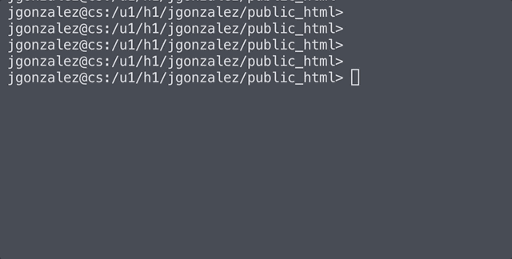

<div align="center">

  <!-- CYBERNETIC TERMINAL ANIMATED HUD HEADER -->
  <a href="https://github.com/cybparam">
    
  </a>

  <br/>

  <!-- DYNAMIC TYPING SVG STREAM -->
  <a href="https://github.com/cybparam">
    
  </a>

  <!-- STATUS CHIPS & METRICS -->
  <p>
    <a href="https://github.com/cybparam?tab=repositories">
      
    </a>
    
    
    
  </p>

</div>


<br/>

```text
╭── [ SESSION: 0x7F9A // cybparam@neural-rig: ~ ] ──────────────────────────────────────────╮
│                                                                                           │
│  [+] IDENTITY     : cybparam                                                              │
│  [+] CODENAME     : Cybernetic Architect & Systems Builder                                │
│  [+] CLEARANCE    : LEVEL 5 // BLACK-OPS (RESTRICTED)                                     │
│  [+] LOCATION     : Encrypted Nodes // 127.0.0.1 // The Digital Aether                    │
│  [+] CORE FOCUS   : Python · Autonomous AI Agents · Reinforcement Models · Linux Systems  │
│  [+] PHILOSOPHY   : Learn -> Decompile -> Construct -> Automate -> Repeat                 │
│  [+] CURRENT RUN  : Training reinforcement neural agents & building stealth tooling       │
│  [+] SYS STATUS   : ONLINE // ALL GHOST CHANNELS SYNCHRONIZED                             │
│                                                                                           │
╰───────────────────────────────────────────────────────────────────────────────────────────╯
```

<div align="center">
  <p><b><code>[ LIVE TERMINAL RAIN // MAINFRAME PACKET STREAM ]</code></b></p>
  
</div>

<br/>


### ⚡ `// 01. ACTIVE CYBER PAYLOADS & REPOSITORIES`

| Targeted Node | Signal & Mission Classification | Protocol | Status |
| :--- | :--- | :---: | :---: |
| **[tic-tac-toe-ai](https://github.com/cybparam/tic-tac-toe-ai)** | Self-learning reinforcement agent trained over 200,000 game cycles. | `Q-LEARNING / PY` | `● DEPLOYED` |
| **[cybparam](https://github.com/cybparam/cybparam)** | Root configuration dossier & live telemetry terminal dashboard. | `MARKDOWN / SVG` | `● LIVE` |
| **[neural-vault](https://github.com/cybparam)** | Experimental autonomous neural networks & algorithmic exploration. | `AI / EXPLORATION` | `○ IN PROGRESS` |

<br/>


### 🛠️ `// 02. CYBERNETIC ARSENAL [WEAPONIZED TECH STACK]`

<div align="center">
  <p>
    <a href="https://skillicons.dev">
      
    </a>
  </p>
</div>

```text
┌── [ SUBSYSTEM INVENTORY ] ────────────────────────────────────────────────────────────────┐
│  • CORE RUNTIMES  : Python 3.12+, C/C++, Bash Scripting                                   │
│  • NEURAL MATRIX  : PyTorch, Reinforcement Learning (Q-Learning), Heuristic Algorithms    │
│  • HOST SYSTEMS   : Linux (Arch / Debian Kernel Hardened), Docker Containerization        │
│  • DEV RIG        : VS Code (Dark Cyber), Git CLI, Terminal Emulators, GitHub Actions      │
│  • PROTOCOLS      : REST APIs, WebSockets, Zero-Knowledge Encryption, JSON/YAML Specs     │
└───────────────────────────────────────────────────────────────────────────────────────────┘
```

<br/>


### 📊 `// 03. LIVE TELEMETRY & MAINFRAME METRICS`

<div align="center">
  <!-- Interactive Terminal Stats Simulation -->
  <a href="https://github.com/cybparam">
    
  </a>
</div>

<br/>

<div align="center">
  <!-- GitHub Readme Stats & Top Languages with Custom Cyberpunk Theme -->
  <a href="https://github.com/cybparam">
    
  </a>
  &nbsp;
  <a href="https://github.com/cybparam">
    
  </a>
</div>

<br/>

<div align="center">
  <!-- Contribution Streak with Cyberpunk Palette -->
  <a href="https://github.com/cybparam">
    
  </a>
</div>

<br/>

<!-- Real-time Hardware & Neural Telemetry HUD Widget -->


<br/>


### 🔒 `// 04. CLASSIFIED ENCRYPTED ARCHIVES`

<details>
  <summary><b>▶ [CLICK TO DECRYPT] CLASSIFIED OPERATOR LOGS &amp; MISSION DIRECTIVES</b></summary>
  <br/>

```text
========================================================================================
[LOG #4092] STATUS: ACCESS_LOGGED // TRANSMISSION INTERCEPTED
----------------------------------------------------------------------------------------
"Most people see code as syntax. I see it as synthetic architecture.
 When you build an autonomous agent, you aren't just giving instructions to a machine;
 you are shaping an entity that reasons through state spaces in milliseconds."

OBJECTIVES & MILESTONES:
  [✔] Infiltrate low-level algorithm design & memory concepts
  [✔] Construct self-optimizing game agents (Tic-Tac-Toe Q-Learning)
  [~] Expanding to deeper reinforcement models & neural networks
  [~] Deploying robust, fault-tolerant autonomous workflows
========================================================================================
```
</details>

<details>
  <summary><b>▶ [CLICK TO DECRYPT] QUANTUM MAINFRAME SPECIFICATIONS</b></summary>
  <br/>

```text
┌── [ SYSTEM ARCHITECTURE SPECS ] ──────────────────────────────────────────────────────┐
│  • OS ARCHITECTURE  : x86_64 Linux / Hardened Micro-Kernel                           │
│  • SHELL INTERFACE  : ZSH + Powerlevel10k + Cyberpunk Prompts                         │
│  • CIPHER SECURITY  : Zero-Knowledge Protocols / PGP 4096-bit                         │
│  • COMPILER OPTIM   : -O3 -march=native -ffast-math                                   │
│  • TELEMETRY FEED   : WebSocket Encrypted Neural Pipe                                 │
└───────────────────────────────────────────────────────────────────────────────────────┘
```
</details>

<details>
  <summary><b>▶ [CLICK TO DECRYPT] ESTABLISH SECURE HANDSHAKE (COMMS)</b></summary>
  <br/>

```text
┌── [ SECURE UPLINK CHANNELS ] ─────────────────────────────────────────────────────────┐
│  • GITHUB COMM     : https://github.com/cybparam                                      │
│  • PUSH PROTOCOL   : Issues, PRs, and collaborative neural forks welcome              │
│  • HANDSHAKE VIBE  : Open to discussing AI, systems engineering & obscure ideas       │
│  • STATUS          : Online, debugging something weird in the dark                    │
└───────────────────────────────────────────────────────────────────────────────────────┘
```
</details>

<br/>


<div align="center">
  <p>
    <a href="https://github.com/cybparam">
      
    </a>
  </p>
  <sub><i>“The sky above the port was the color of television, tuned to a dead channel.” — William Gibson, Neuromancer</i></sub>
</div>
