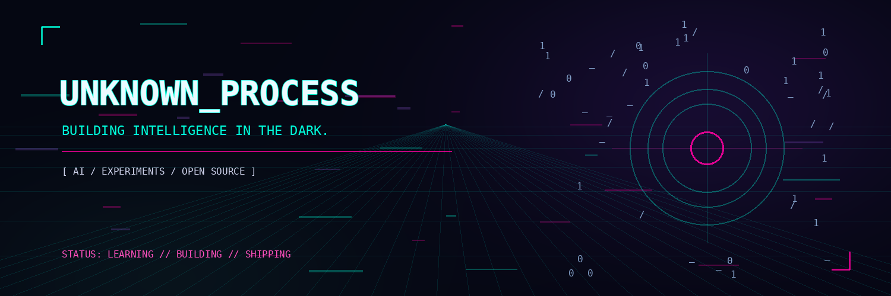

<div align="center">
  

  <h1>⟢ cybparam ⟣</h1>
  <p><code>quietly building things that might matter.</code></p>

  <p>
    <a href="https://github.com/cybparam?tab=repositories">
      
    </a>
    
    
  </p>
</div>

---

```text
┌─ SYSTEM PROFILE ──────────────────────────────────────────┐
│  ROLE      Computer Science student / curious builder     │
│  FOCUS     Python · AI experiments · useful weird ideas   │
│  METHOD    Learn → build → break → understand → repeat    │
│  STATUS    online, probably debugging something           │
└───────────────────────────────────────────────────────────┘
```

## `// signal`

I like figuring out how things work by building them from scratch.  
Currently exploring Python, AI fundamentals, and projects that teach me something real.

I don't have everything figured out. That's the point.

## `// current experiments`

| Project | Signal |
| --- | --- |
| **[Tic-Tac-Toe AI](https://github.com/cybparam?tab=repositories)** | A self-learning Tic-Tac-Toe agent trained on 200,000 games. |
| **[Next experiment](https://github.com/cybparam)** | The next idea is probably already taking over a notebook. |

> Replace the links above with your real repository URLs. Keep only projects that are public and ready to show.

## `// tools in the lab`

<p align="left">
  
</p>

## `// live telemetry`

<p align="center">
  
  
</p>

<p align="center">
  
</p>

## `// outside the terminal`

- GitHub: [@cybparam](https://github.com/cybparam)
- Open to: learning in public, collaborating, and thoughtful open-source contributions.

<div align="center">
  <sub>“A better version of me is still compiling.”</sub>
</div>
